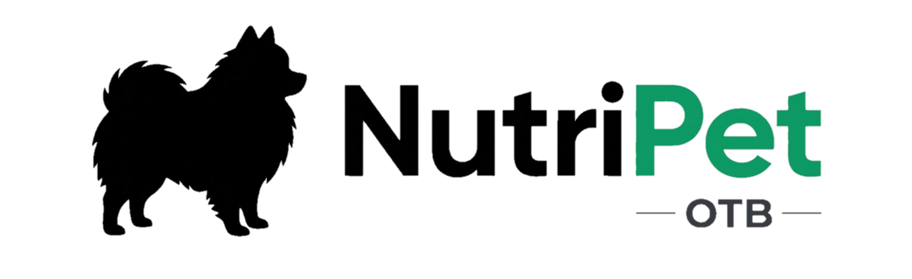

<div align="center">
  

  <h1>NutriPet — OTB</h1>
  <p>
    Plataforma integral de nutrición clínica, seguimiento médico y pasaporte digital de emergencia para perros y gatos.
  </p>

  <p>
    
    
    
    
    
  </p>
</div>

---

## Descripción

**NutriPet OTB** centraliza en una única aplicación web progresiva (PWA) el cálculo nutricional diario, el expediente clínico y la identificación rápida de mascotas ante emergencias. Toda la dosificación energética y nutricional se calcula en el dispositivo del usuario tomando como referencia las pautas **FEDIAF** y **NRC**, con respaldo multi-dispositivo en la nube y persistencia local para consulta sin conexión.

---

## Módulos Principales

- **Calculadora Metabólica & Presupuesto de Alimentación:** Cálculo de **RER** y **MER** ajustado por especie, edad, esterilización y nivel de actividad física, con soporte para alimentación en croquetas secas, dieta mixta (50/50) y **BARF 100% fresca**, proyección de rendimiento por saco o lote y selector multidivisa (`COP`, `USD`, `MXN`, `EUR`, `ARS`, `CLP`, `PEN`).
- **Credencial Clínica & Modo SOS con QR:** Carnet digital interactivo de doble cara (anverso clínico y reverso de emergencia) con acceso directo por teléfono al veterinario y tutor responsable, alertas de alergias, exportación a **PDF** y enlace público escaneable por código **QR**.
- **Curva y Control de Peso:** Gráfica evolutiva de peso frente a la meta ideal recomendada según raza, simulador de ritmo semanal (gradual, recomendado, activo) e historial de pesajes.
- **Historial Clínico & Calendario de Recordatorios:** Registro organizado de consultas, vacunas, desparasitaciones, cirugías, exámenes e imágenes diagnósticas con agenda de vencimientos.
- **Organizador de Rutina & Hábitos:** Cronograma diario de tomas, hidratación y paseos sincronizado automáticamente con el gramaje calculado de la mascota y exportable para impresión.
- **Semáforo Toxicológico, Razas & Marcas:** Guía rápida de alimentos seguros, restringidos y tóxicos, enciclopedia de susceptibilidades por raza, recetas caseras/BARF y comparativa de líneas alimenticias por país.

---

## Stack Tecnológico

| Capa | Tecnologías |
| :--- | :--- |
| **Interfaz** | React 19, TypeScript, Tailwind CSS v4 (`@tailwindcss/vite`), Lucide Icons, Motion |
| **Empaquetado y PWA** | Vite 8, `vite-plugin-pwa` (Workbox), `esbuild` |
| **Datos y Auth** | Firebase Authentication (Google), Cloud Firestore (`persistentLocalCache`), IndexedDB |
| **Gráficas y Documentos** | Recharts, `qrcode`, `jsPDF`, `html2canvas-pro` |
| **Servidor y Móvil** | Express, React Router DOM v7, Capacitor (Android) |

---

## Puesta en Marcha Local

### Requisitos previos

- Node.js 20 o superior
- Cuenta y proyecto en Firebase (Authentication con Google y Firestore habilitados)

### Instalación

1. Clona el repositorio e instala las dependencias:

```bash
npm install
```

2. Configura las variables de entorno tomando `.env.example` como referencia en tu `.env` local:

```env
# Aplicación y servidor local
APP_URL=http://localhost:3000
ALLOWED_ORIGIN=http://localhost:3000

# Configuración cliente Firebase
VITE_FIREBASE_API_KEY=
VITE_FIREBASE_AUTH_DOMAIN=
VITE_FIREBASE_PROJECT_ID=
VITE_FIREBASE_STORAGE_BUCKET=
VITE_FIREBASE_MESSAGING_SENDER_ID=
VITE_FIREBASE_APP_ID=
```

3. Inicia el entorno de desarrollo:

```bash
npm run dev
```

---

## Scripts Disponibles

| Comando | Descripción |
| :--- | :--- |
| `npm run dev` | Levanta el servidor de desarrollo junto con Vite. |
| `npm run build` | Genera el bundle de producción en `dist/` y empaqueta `dist/server.cjs`. |
| `npm run preview` | Previsualiza localmente el build de producción. |
| `npm start` | Ejecuta el servidor compilado en producción (`dist/server.cjs`). |
| `npm run lint` | Ejecuta la verificación de tipos con TypeScript (`tsc --noEmit`). |

---

## Estructura General

```text
src/
├── App.tsx                       # Layout principal, cabecera, vistas y pie de página
├── index.css                     # Tokens de color, tipografía y temas visuales
├── main.tsx                      # Enrutamiento principal (/ y /sign-in)
├── config/                       # Inicialización de Firebase y caché persistente
├── context/                      # Estado global de autenticación, mascotas y suscripción
├── hooks/                        # Preferencias de fondo y persistencia local
├── pages/
│   └── LoginPage.tsx             # Pantalla de acceso con Google y modo exploración
└── components/
    ├── Sidebar.tsx               # Menú lateral de escritorio y barra inferior móvil
    ├── PetHeaderBar.tsx          # Selector rápido de mascota y controles de sesión
    ├── UnifiedFoodCalculator.tsx # Rendimiento por saco/lote y presupuesto
    ├── PetTechSheet.tsx          # Credencial clínica, modo SOS QR e historial de peso
    ├── PublicPetProfile.tsx      # Ficha pública de emergencia al escanear el QR
    ├── RoutineSchedule.tsx       # Organizador de rutina y horarios
    ├── MedicalHistory.tsx        # Expediente clínico por categorías
    └── RemindersModule.tsx       # Vacunas y alertas programadas
```

---

## Aviso Clínico

NutriPet OTB ofrece herramientas de cálculo y organización orientadas al cuidado preventivo basadas en referencias nutricionales estándar (**FEDIAF** y **NRC**). No sustituye el diagnóstico, prescripción ni seguimiento presencial de un médico veterinario colegiado.

---

## Comunidad Oficial

- Facebook: [@NutriPet.v2](https://www.facebook.com/NutriPet.v2)
- TikTok: [@nutripetv2](https://www.tiktok.com/@nutripetv2)
